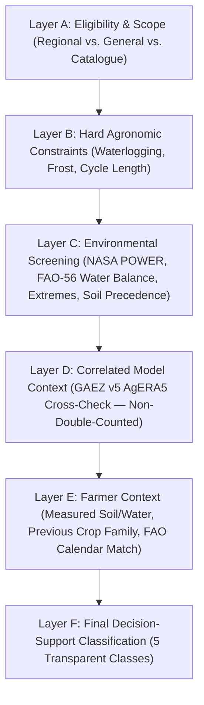

# Six-Layer Evidence Combination and Automated Dataset Refresh Governance

**Date:** 2026-11-09  
**Scope:** Section 17 (`Automated Dataset Refresh and Governance`) & Section 18 (`Scientifically Defensible Evidence Combination`)

---

## 1. Six-Layer Scientific Evidence Combination (`agroshift/evidence_combination.py`)

### Layer Definitions & Rules
- **Layer A — Eligibility and Scope (`layer_a_eligibility`):**
  - Separates every input into its strict epistemological category: `observed_data`, `reanalysis_or_modelled`, `published_references`, `farmer_measurements`, `farmer_estimates`, `hypothetical_simulations`, and `unknown_information`.
- **Layer B — Hard Agronomic Constraints (`layer_b_hard_constraints`):**
  - Enforces non-compensatory biological/physical constraints (e.g., persistent waterlogging for drainage-requiring crops, window shorter than minimum cycle length, or $\ge 50\%$ historical frost season frequency for frost-intolerant tropical crops). A Layer B blocker cannot be overridden by favorable averages in Layers C–E.
- **Layer C — Environmental Screening (`layer_c_environmental`):**
  - Integrates historical NASA POWER temperature fit, FAO-56 Penman-Monteith/Hargreaves crop water balance (`agroshift/water_balance.py`), extreme weather distribution (`agroshift/extremes.py`), and measured-first soil pH reconciliation (`agroshift/soil.py:reconcile_soil_evidence`).
- **Layer D — Correlated Model Context (`layer_d_correlated_models`):**
  - Cross-checks screening status against FAO/IIASA GAEZ v5 (`RES05-SIX.HP0120.AGERA5.HIST`).
  - **Non-Double-Counting Invariant (`correlated_reanalysis_double_counted = False`):** Because GAEZ v5 (`AgERA5`) and NASA POWER (`MERRA-2`) derive from correlated historical atmospheric reanalyses, GAEZ v5 is never added to climate suitability scores; instead, when a crop passes local temperature/pH checks (`possible`) but GAEZ v5 classifies the ~10 km cell as `Very marginal` (7) or `Not suitable` (8), Layer D flags `alignment_with_screening = "divergent_caution"` and shifts Layer F from `"Worth investigating"` to `"Conditional compatibility"`.
- **Layer E — Farmer Constraints and Field Context (`layer_e_farmer_context`):**
  - Evaluates botanical family succession against `farm.current` (`same_family_succession_warning`) and compares the farmer's growing window against FAO Crop Calendar zone dates (`match_crop_calendar`).
- **Layer F — Final Decision-Support Classification (`layer_f_classification`):**
  - Assigns one of 5 transparent classifications:
    1. `Worth investigating` (`worth_investigating`)
    2. `Conditional compatibility` (`conditional_compatibility`)
    3. `Important constraints identified` (`important_constraints`)
    4. `Not compatible with documented conditions` (`not_compatible`)
    5. `Insufficient evidence` (`insufficient_evidence`)

---

## 2. Automated Dataset Refresh and Governance (`agroshift/refresh_manager.py`, `scripts/refresh_provider_data.py`)

- **Governed Policies (`ag_refresh_policy`):**
  - `nasa_power_daily_ag`: 30-day cache TTL, SHA-256 envelope verification, exact or same-grid-cell cache validation, offline fallback to 34 verified station archives.
  - `fao_gaez_v5_res05_six`: 180-day refresh cadence via `scripts/refresh_provider_data.py gaez`, verifying `_readme_res05.xlsx` file inventory, SLD color legend, `(4320, 2160)` mode `P` WGS84 geometry, and SHA-256 manifest digests across all 48 rasters.
  - `isric_soilgrids_v2_wcs`: 90-day refresh cadence, `5×5` `GEOTIFF_INT16` EPSG:4326 subset verification, unit scaling check, and strict preservation of farmer soil-test precedence.
  - `fao_crop_calendar_v1`: 90-day refresh cadence, country/crop binding verification, and non-destructive calendar comparison.
  - `faostat_qcl_bulk`: 180-day refresh cadence via `scripts/refresh_provider_data.py faostat`, verifying ZIP and row-level SHA-256 digests and official FAO observation flags.
- **Atomic Release & Rollback:** `agroshift/knowledge_store.py:import_file` executes inside a serialized database transaction (`pg_advisory_xact_lock` on PostgreSQL / `BEGIN IMMEDIATE` on SQLite), verifies `ag_conflicts`, and rolls back completely on any schema, foreign-key, or range failure while logging the failure class in `ag_import_history`.
