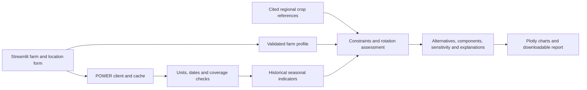

# AgroShift AI: investigation and preparation plan

Prepared 4 November 2026, Asia/Colombo. These are research findings and proposed
engineering decisions. No competition application has been implemented.
Source IDs refer to [SOURCES.md](SOURCES.md).

## 1. Challenge analysis and event rules

The official indexed summary requires a decision-support tool connecting NASA
Earth observations, local soil information, crop characteristics and farmer
priorities to exploration of crop rotations and resilience (C01–C02). This makes
rotation alternatives and their agricultural context central to the product.

Our acceptance mapping is:

| Challenge element | Proposed evidence in the application |
|---|---|
| NASA observations | Actual POWER series drive season-specific environmental comparisons. |
| Local soils | Farmer-reported texture, drainage, optional pH and nutrients retain unknown values. |
| Crop characteristics | Every assessed characteristic carries a reference and applicability scope. |
| Farmer priorities | Users choose trade-offs and see the effect on comparisons. |
| Rotation strategies | Same planning horizon, existing rotation plus alternative sequences, explicit transitions. |
| Soil health and adaptation | Conditional rotation explanations, exposed constraints and sensitivity. |

The local organizer's reproduction (C06) suggests several NASA datasets and at
least three strategies including the existing rotation. Its wording makes those
suggestions, not an independently verified global checklist. Our engineering
target is three comparisons because it makes trade-offs visible. A chatbot,
trained ML model, all listed satellite products, and worldwide agronomic coverage
are not requirements established by the verified summary.

**Verification remains incomplete.** Official 2026 dates are confirmed as
14–15 November. Direct access to the full challenge, FAQ, legal, and submission
pages failed through several routes. Local organizer guidance says tools can be
prepared now and project work starts at the event; guides/resources are expected
13 November (C07). Until the global rules can be read, keep work to research,
environment preparation and independent learning. Do not reuse these exercises
as competition code without checking the reuse policy. The user also explicitly
requires START HACKATHON before implementation.

Before that start, verify and record:

- Registration, solo/team eligibility, team-size limit and event association.
- Exact allowed start and deadline, governing timezone and any earlier local pitch cutoff.
- Pre-existing code, research, design, data snapshots and AI assistance rules.
- Required NASA attribution, licenses and branding rules.
- Submission fields, lengths, language, video duration/format and public-link requirements.
- Official judging criteria and weights; current resource list.

Use impact, creativity, scientific validity, relevance and presentation as our
provisional review lenses. Do not label assumed weights or historical criteria
as the verified 2026 rubric. Prepare a submission inventory (summary, approach,
NASA/other sources, limitations, source/demo links, video, team roles and AI-use
record); map it to the actual fields when available. No final submission wording
or confirmed deadline has been invented.

## 2. Dataset investigation

| Dataset | Access, period and scale | Proposed role / limits |
|---|---|---|
| POWER meteorology | Public daily point JSON, no account in our executed requests. Standard MERRA-2 history from 1981; GEOS-IT recent continuation. 0.5° latitude × 0.625° longitude. | P0: precipitation and temperature. Coarse gridded estimates informed by observations, not farm weather stations. |
| POWER solar | Same service; source-dependent history from 1984, CERES era from 2001. Generally ~1° grid for modern standard solar data. | Radiation context; ET inputs only if the complete method is supported. Check source metadata for selected years. |
| SMAP SPL3SMP_E v6 | Daily HDF5 from March 2015; Earthdata/NSIDC access, generally login for downloads; 9 km grid. | P2 regional surface wetness. Approximately top 5 cm; radiometer footprint ~36 km, not 9 km independent farm measurements. Quality masking essential. |
| SMAP SPL4SMGP v8 | Model-assimilated surface/root-zone moisture, 3-hourly, 9 km, mission record from 2015. | P2 only. Different from L3 satellite retrievals. Check 2026 reprocessing notice (D09). |
| MODIS MOD13Q1 Collection 6.1 | Terra 250 m, 16-day composites since February 2000; Earthdata/LAADS, authenticated downloads or subset tools. | P2 vegetation context; clouds, composites and mixed pixels limit small-farm use. NDVI does not measure nutrients or yield. |
| GPM IMERG through POWER | Documentation lists daily UTC IMERG_PRECTOT, 0.1°, from June 1998; Final data delayed, Late data newer. | Useful later rainfall cross-check. Not tested here. Keep time basis and source separate from LST POWER precipitation. |

Sources: D01–D12. Select one stable multi-year period for P0: **2001–2025**,
subject to observed coverage. This provides 25 complete calendar years in the
modern solar era, not a claimed 30-year climate normal or future forecast.
Query in bounded year chunks and cache, with explicit progress/cancellation.

Parameters verified in actual AG daily responses:

| Code | Returned units | Use |
|---|---|---|
| T2M | C | Daily mean temperature |
| T2M_MIN, T2M_MAX | C | Daily temperature extremes |
| PRECTOTCORR | mm/day | Daily precipitation rate; integrate over each one-day interval for mm |
| RH2M | % | Humidity context |
| ALLSKY_SFC_SW_DWN | MJ/m^2/day | Solar energy input |

For future FAO-56 ETo, investigate WS2M and the additional atmospheric/pressure
inputs required by the chosen formulation. Do not label ETo as calculated from
the six basic parameters alone. Units are read from each response: if another
community returns kWh/m²/day, conversion to MJ/m²/day is ×3.6.

Proposed final client behavior: validate finite coordinates in [-90,90] and
[-180,180], date order and supported parameter allowlist; explicit LST; connect
timeout 10 s/read timeout 60 s; at most three attempts on transient network,
429 or 5xx errors with bounded backoff and Retry-After; no retry for bad 4xx
requests. Validate schema and date alignment, map the returned fill sentinel
to missing, inspect messages, reject unknown units, and preserve provenance.
Cache validated public environmental responses by canonical request, time
standard and client schema version. Store fetched-at, source/version and hash;
use atomic writes and show cache age. A failed request can fall back only to a
matching actual cached dataset, never a fabricated series or a different place.
These policies are proposed; the learning exercise is not that production client.

## 3. Product architecture

Use one Streamlit process with ordinary Python modules, Pandas/NumPy, Plotly,
Requests, JSON references and Pytest. No GPU, separate API server, database,
React frontend or required LLM. Small JSON reference packs make review and
regional extension easier than a database at this scale.

Future module boundaries: `data/power`, `data/validation`, `climate/indicators`,
`knowledge/regions`, `decision/candidates`, `decision/assessment`,
`decision/sensitivity`, `ui`, `reporting`, `tests`. This is a proposed file
layout, not a claim these modules exist.

Location: country selector and typed coordinates first, search and click map
after the core flow. Persist only in Streamlit session state initially. A place
name is not a farm boundary. Country choice alone cannot certify agronomic
support: verify the actual selected location against a reference pack's coverage.
If geography or the local season cannot be verified, keep climate exploration
available and label agricultural assessment unsupported.

Region packs carry country/region IDs, geographic scope, local calendars,
cultivars, applicable systems, references, review status and review date.
Only validated packs may eventually be called validated. Sri Lanka starts as
the reference-informed pilot; tests and literature checks are not field validation.

Farm profile: area/unit; previous/current crops; existing planned rotation;
two dated future crop slots; texture; drainage/waterlogging; pH with measurement
date; optional N/P/K values with units/test method; irrigation availability,
reliability and optional measured amount; water limits; objectives; allowed
crops; residue handling. Unknown is explicit. Numeric nutrients remain context
until a supported interpretation exists. A yes/no irrigation answer does not
imply a volume or guaranteed supply.

Keep the interface to a guided flow, with overview and sources always reachable:
Farm setup → historical climate → rotation comparison → scenario/report.
Use restrained dark green, warm off-white and one amber caution color; pair
color with text/icons. Put sequence timelines and side-by-side components
ahead of decorative maps. Test keyboard use, narrow screens and useful errors.

## 4. Scientific modelling

The proposal is **constraint filtering plus a transparent additive preference
model**, with scenario analysis. It is an exploratory decision aid, not a
trained prediction model. Swing weighting is preferable to unexplained
importance sliders: ask which improvement from the displayed worst to best
criterion outcome matters most (A08).

### Climate calculations

- Reindex each series to the complete requested daily calendar. Detect missing,
  duplicate and invalid dates. Never convert missing precipitation to zero.
- Monthly and annual rainfall: integrate daily values and sum only complete
  periods for the principal total. An incomplete observed subtotal may be shown
  separately with coverage, never passed off as a complete total.
- Temperature: daily-weighted mean, max of T2M_MAX and min of T2M_MIN. Show coverage.
  A provisional 90% coverage screen for means is an engineering policy, not a
  biological threshold; flag contiguous gaps separately.
- Interannual rainfall: distributions of complete equivalent seasons, median,
  quartiles and coefficient of variation only when the mean is nonzero and
  enough valid seasons exist. Propose at least 10 complete seasons for rankings;
  expose the sample count and test sensitivity to this policy.
- Dry spells: longest run of days below 1 mm; this threshold follows the
  [Climdex CDD definition](https://www.climdex.org/learn/indices/). Count within
  the explicitly selected crop window; missing days interrupt the known run,
  so incomplete results are lower bounds and not directly comparable as complete
  CDD. This windowed indicator is not a claim to reproduce every official
  annual ETCCDI convention.
- Seasons: explicit sowing/harvest dates, including year crossing and leap days.
  Sri Lankan Maha/Yala labels are local presets to check, never global defaults.
- Heat/cold exposure: add crop-stage-specific exceedances only when the relevant
  threshold and applicable measurement are sourced. Seasonal average temperature
  inside a preferred range does not exclude damaging daily extremes.

### Crop reference evidence needed

The five requested crops are research candidates, not a validated database.

| Crop | Initial evidence | Still required before quantitative scoring |
|---|---|---|
| Rice | FAO indicative ET and RRDI lowland water processes (A01/A02/A06) | Local cultivar duration, stage sensitivity, production system, field losses and calendar |
| Mung bean | DOA Sinhala cultivation guidance, drainage and planting context (A03) | Reviewed translation, cultivar duration and species-specific water data |
| Cowpea | Regional DOA guidance including waterlogging sensitivity (A04) | Local cultivar response and species-specific ET/water evidence |
| Maize | FAO indicative water range and DOA regional guidance (A02/A04) | Local variety/calendar, temperature-stage interpretation |
| Groundnut | FAO indicative water range and DOA soil/season guidance (A02/A04) | Local duration, soil/drainage applicability and rotation evidence |

Every future numeric field needs value/range, units, source/page, crop/cultivar,
region, growth stage, irrigation regime and evidence status. Preferred conditions,
tolerated limits and lethal limits must be different fields. Never use generic
FAO bean values for either mung bean or cowpea. Conflicting references remain
visible until reconciled; do not average incompatible thresholds.

### Candidate generation and rotation effects

Use the same two future seasonal windows for every alternative. Include the
farmer's existing rotation as baseline, even if it is flagged or unassessable.
Keep the known previous/current crop history fixed. Generate candidates from
allowed crops with supported local calendars and non-overlapping durations.

For discussion only: a farmer planning rice then rice might compare that plan
with rice then mung bean and rice then cowpea. Those alternatives require
appropriate seasons, drainage and local evidence; they are not recommendations
for all Sri Lankan paddy land. Evaluate every transition, not just the final crop.
Crop-family diversity alone is not evidence of a specific pest-cycle break.

Documented infeasibility is a hard constraint that no preference weight can
override. Unknown drainage or missing variety duration makes a candidate
conditional, rather than falsely eligible or categorically impossible. Model
potential legume/residue effects qualitatively until local evidence supports
numbers. Never award a guaranteed nitrogen amount or yield benefit.

### Water assessment

Rainfall is an environmental input, not effective crop water. P0 compares
historical rainfall/dry spells with cited crop water-dependence information and
explicit irrigation reliability/constraints. If reliable ET or water supply
data are missing, show a partial qualitative comparison and do not claim a
calculated irrigation deficit or full water-sufficiency score.

The scientifically stronger extension is FAO-56 reference ET and stage-specific
crop ET, plus effective rainfall, root-zone storage, irrigation and losses:

`ETc(t) = Kc(t) × ETo(t)`

`storage_end = storage_start + rain + irrigation + capillary_rise - runoff - drainage - actual_ET`

That extension requires measured or explicitly assumed inputs and a validated
implementation (A01). Paddy adds land preparation, ponding and seepage processes
(A06), so its indicative ET cannot be used as its total irrigation need. A
constant rainfall-use fraction may be a user-defined sensitivity assumption,
but cannot be labelled a measured effective-rainfall model.

### Relative scoring, missing information and explanations

For assessed criteria with fixed, documented 0–1 value scales:

`w_k = priority_k / sum(priority)`

`S(rotation, scenario) = 100 × sum_k(w_k × v_k(rotation, scenario))`

Reject negative weights and an all-zero vector. Start with equal weights as a
clearly labelled exploratory preset, not an empirically learned truth. Explain
each scale's endpoints and allow swing-weight changes. Avoid double counting
rainfall in separate climate and water scores; temperature, water exposure,
soil fit and supported rotation attributes must have distinct contributions.

Use fixed scales, not candidate-dependent min/max rescaling that can change a
ranking when an irrelevant option is added. Aggregate crop-slot components
with a disclosed rule and separately expose the weakest slot; hard failures
always override averaged advantages.

Unknown components are not invented as 0.5, and missing criteria must not be
silently dropped and renormalized differently per rotation. Compare the same
supported dimensions across alternatives; show excluded dimensions and weighted
evidence coverage. Where appropriate, propagate unknown values as [0,1] into
an overall score interval. Overlapping intervals or unresolved feasibility mean
the app cannot establish a confident ordering. The score is preference under
assumptions, never percent probability, yield or validated agronomic suitability.

Each result must carry sequence, relative/conditional rank, components, benefits,
constraints, assumptions, missing inputs, source links and provenance. Keep
climate coverage, reference applicability, missing farm data and sensitivity
separate; do not invent a single statistical confidence percentage.

Sensitivity uses complete historical seasons and explicit hypothetical changes
(rainfall amount, temperature, irrigation reliability, priorities, soil inputs).
Recompute eligibility and components, show rank changes and distinguish changed
scenarios from observations. A percent-rainfall multiplier does not simulate a
changed storm sequence. Count of tested scenarios won is not probability of success.

## 5. AI feasibility

P0 is the transparent decision engine. Basic historical percentiles and anomaly
summaries are useful without machine learning. Label them statistics.

P2 clustering could explore standardized seasonal patterns after checking sample
size and cluster stability, but 25 annual samples at one point is small. Its
clusters do not forecast next season. No adequate labelled Sri Lankan farm-level
rotation dataset has been verified in this investigation. [FAOSTAT annual
national yield data](https://data.fao.org/catalog/iso/d24a448b-3b62-4c09-8c1d-4a39bb599876)
cannot by itself validate a field-level rotation effect: the units and
confounding factors differ. This is a modelling inference, not a claim that no
suitable dataset exists anywhere.

Defer Random Forest/XGBoost yield or profit forecasts. If suitable data later
arrives, split by time and geography/farm, fit preprocessing on training only,
compare with simple baselines and report held-out errors and scope.

An optional LLM may explain the already calculated result and cite supplied
references. It cannot invent independent recommendations. Use deterministic
template explanations first. Runtime must work with no API key. Do not market
the word AI as proof that a predictive model exists.

## 6. Five greatest risks

| Risk | Practical mitigation and stop condition |
|---|---|
| Competition eligibility/rules uncertainty | Read current guides and registered event schedule before project work. Preserve dated preparation history and AI contributions; do not assume reuse is permitted. |
| Unsupported agronomic claims | Restrict pilot scope; track source applicability; obtain local review; remove unsupported numeric scores/crops rather than fabricate thresholds. |
| Misreading coarse/rainfall data as farm water | Show grid/time/source labels; separate measured/modelled/assumed inputs; add drainage; no yield or irrigation promises. |
| NASA outages, changed schemas or gaps | Bounded retries, units/schema checks, raw provenance, real cached fallback, complete-period filters and explicit failure states. |
| Solo 48-hour scope and assistant handoff | One vertical workflow; three crops first; integration deadlines; defer satellite processing/ML/chat; keep plain-text state and locked dependencies. |

## 7. Preparation: 4–13 November

These are research and independent learning activities. A specific rule found
later may narrow them; planning does not establish permission to pre-build.

| Date (Colombo) | Activity | Concrete output |
|---|---|---|
| Nov 4 | Challenge/rules investigation, WSL check, one small public API exercise | This evidence pack; next priority is obtaining current terms/event schedule |
| Nov 5 | Python lists/dicts/functions, venv/pip, Git and JSON | Standalone learning notes; run built-in Streamlit hello |
| Nov 6 | Read POWER docs; inspect independent historical samples | Understand units, fill sentinel, timestamps and provenance |
| Nov 7 | Practice Pandas dates, missing values and aggregations on a separate teaching dataset | Explain a missing-rainfall failure and year-crossing window |
| Nov 8 | Read DOA/RRDI cultivation and season references | Cited literature notes and unresolved crop fields |
| Nov 9 | Read FAO-56 and rice water processes; review drainage | Explain ET versus rain versus irrigation in your own words |
| Nov 10 | Learn additive MCDA on a non-agricultural toy example | Explain normalized weights, missing criteria and sensitivity |
| Nov 11 | Generic Streamlit forms/session state and Plotly tutorials; inspect hosting requirements | Confirm laptop tooling; hosting account access if already available |
| Nov 12 | Review agronomic evidence and seek local expert feedback if possible; rehearse generic Git/deploy workflow | Risk list and clearly recorded review status |
| Nov 13 | Recheck full official challenge, resources, terms, judging and submission guides; record event timezone | Final allowed scope, deadline checklist and rest before the event |

No emails or external messages have been sent. The user can seek organizer or
agronomist clarification; this document is not a claim that they have done so.

## 8. Hackathon execution: provisional November 14–15

The following is a Colombo planning schedule **assuming an allowed start at
09:00 on November 14 and a deadline later than 21:30 on November 15**. These
times are not verified event rules. Shift the whole plan to the registered
event's confirmed window and reserve at least two hours before its deadline.

| Time | Work and checkpoint |
|---|---|
| Nov 14, 09:00–10:00 | Verify START HACKATHON/time/rules; create entry repository, environment and allowed attribution; freeze small scope |
| 10:00–13:00 | POWER client, validation, real cache; success/error/coordinate tests |
| 13:00–14:00 | Meal/buffer; fetch representative history |
| 14:00–17:00 | Climate indicators and farm form; checkpoint: location → real climate with provenance |
| 17:00–20:00 | Reviewed crop references, candidate sequences and feasibility rules |
| 20:00–23:00 | Components, weighted comparison and explanations; checkpoint: first complete rotation workflow |
| 23:00–07:00 | Rest; do not plan a solo all-nighter |
| Nov 15, 07:00–10:00 | Decision tests, missing-input cases, sensitivity; checkpoint: stable P0 |
| 10:00–12:00 | Deploy early; test actual cloud behavior and authentic cached fallback |
| 12:00–13:00 | Meal/buffer |
| 13:00–15:00 | Highest-value P1: simple scenario comparison, downloadable summary, map/search only if time permits |
| 15:00–17:00 | Feature freeze; three scenarios, global climate checks, responsive/error-state review |
| 17:00–19:00 | Record demo, write project page and sources/AI contribution statement |
| 19:00–21:30 | Rehearse, fix only blockers, submit before actual cutoff; verify links and receipt |

If no end-to-end rotation workflow by Saturday evening, defer maps, advanced
reports, further crops and all P2 work. If references cannot support a crop's
numerical water assessment, preserve a clear partial comparison; do not patch
the gap with invented data. Final publishing/submission follows the user's
authorization and the verified form requirements.

Planned tests (none are application tests completed today): API happy path,
422/429/5xx, timeouts, bad schema, sentinel values, empty data, matching-cache
fallback; units and leap dates, incomplete months and cross-year seasons; hard
constraints, zero/negative weights, stable ties, priority changes, missing soil,
insufficient history and scenario invariants; Streamlit form submission,
state invalidation when location changes, chart rendering and report content.

Three proposed agricultural demonstrations use fictional, explicitly labelled
farm inputs and real NASA history: (1) a locally reviewed rice/pulse transition
with suitable drainage; (2) the same farm with restricted irrigation, showing
trade-offs without predetermined rankings; (3) unknown pH/nutrients and poor or
unknown drainage, showing conditional results and missing evidence. Additional
global climate scenarios are Nairobi and Ames; they must not trigger Sri Lankan
crop recommendations. Long-history and UI tests are still planned.

Demo narrative: farmer's existing plan → actual environmental history → three
dated sequences → change one constraint → explain what changed and what remains
unknown. Presentation outline: decision/problem, NASA evidence, rotation method,
demonstration, validity/limitations, next validation step. Confirm video length
before scripting exact durations.

## 9. Initial environment

See [SETUP.md](SETUP.md) for exact commands and [STATUS.md](STATUS.md) for checks
actually completed. WSL2 Ubuntu-26.04 is available, with Python 3.14.4 and Git
2.53.0. Windows VS Code is installed and its launcher is visible inside WSL.
Use the Linux venv, not the Windows Python app-execution alias. Keep heavy
environment files outside the OneDrive workspace. Application dependencies will
be pinned and checked again against the cloud Python version during the event.

## 10. Recommended final scope

Build a global environmental explorer plus a deliberately narrow Sri Lankan
rotation pilot. Begin with rice, mung bean and cowpea, contingent on completing
their evidence; maize and groundnut remain extension candidates. Compare the
baseline and two alternatives over identical dated windows. Show genuine NASA
history, feasibility conditions, component evidence, adjustable trade-offs and
missing information. Basic provenance belongs in P0 even if report export and
a richer source browser remain P1.

P1 is scenario comparison, a downloadable HTML/Markdown/CSV summary, global
location search/map and verified deployment. Avoid PDF generation complexity
until the report content works. P2 is SMAP, MODIS, clustering and a grounded LLM.
Yield/profit prediction, global agricultural recommendations, farm-scale soil
maps and automatic fertilizer prescriptions are outside this event's scope.

The differentiator is a traceable comparison of sequences with visible reasons
and sensitivity. Scientific validation is a separate post-prototype milestone,
not something unit tests or an attractive dashboard can establish.

**Most useful immediate action:** open the official participant FAQ/terms in
your browser or account and establish the registered event's pre-event work
policy and governing start/deadline timezone. That unresolved evidence determines
which preparation can safely be reused. The local learning environment and
small NASA access exercise are already prepared.
